## Hi there 👋  I'm Disha Deshmukh!

  

<h3 align="center">🤖 Aspiring Data Scientist | AI Engineering Student | 🇮🇳 India</h3>

  

  

<h1 align="center">Hey there! 👋 I'm Disha Deshmukh</h1>

  🤖 Aspiring Data Scientist | AI Engineering Student

---

## 🌟 About Me

- 🎓 AI Engineering student passionate about Data Science and Artificial Intelligence.
- 💻 Skilled in C, C++, Python, and SQL.
- 🤖 Exploring Generative AI, LLMs, and AI Agents.
- 🧠 Learning Data Analysis, Machine Learning, and Deep Learning.
- 🔗 Exploring LangChain and Retrieval-Augmented Generation (RAG).
- ✨ Basic familiarity with Claude.
- 💼 Open to Internship and Entry-Level opportunities in Data Science & AI.

---

## 🛠️ Tech Stack & Skills

### 💻 Programming Languages

  

### 🤖 AI & Emerging Technologies

  
  
  
  
  
  

---

## 🧠 Areas of Interest

- 📊 Data Science & Data Analytics
- 🤖 Artificial Intelligence
- 🧬 Machine Learning & Deep Learning
- 💡 Generative AI & Large Language Models
- 🔗 AI Agents & RAG Applications

---

## 📊 GitHub Statistics

  
  

## 🔥 GitHub Contribution Streak

  

---

## 🐍 Contribution Snake

  

---

## 🎯 Current Goals

- Build real-world Python and Data Science projects.
- Explore practical applications of Generative AI.
- Strengthen SQL and analytical skills.
- Develop intelligent AI-powered applications.
- Collaborate with developers and AI enthusiasts.

---

## 🤝 Let's Connect!

  
  

  💼 Open to Internships | Entry-Level Roles | Collaborations

---

<h3 align="center">✨ "Turning curiosity into code and data into intelligence."</h3>

  ⭐ Thanks for visiting my profile! Let's learn and build something amazing together.

!--
**Disha22Deshmukh/Disha22Deshmukh** is a ✨ _special_ ✨ repository because its `README.md` (this file) appears on your GitHub profile.

Here are some ideas to get you started:

- 🔭 I’m currently working on ...
- 🌱 I’m currently learning ...
- 👯 I’m looking to collaborate on ...
- 🤔 I’m looking for help with ...
- 💬 Ask me about ...
- 📫 How to reach me: ...
- 😄 Pronouns: ...
- ⚡ Fun fact: ...
-->
